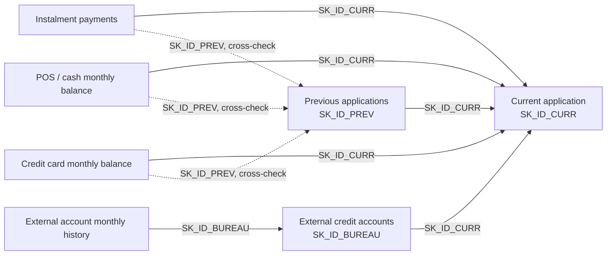
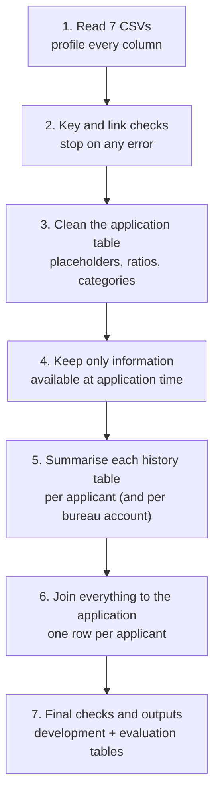

# Asteria Finance project: full overview for the group

**Who this is for.** Every member of Group 14. Read this first: it explains what we are building, every step done so far and why, the final results, the business strategy, which file holds what, and what each of us still has to do. Part 1 is the story and the decisions; Part 2 explains the data processing in detail. You do not need to read code to follow either part.

**Status on 13 November 2026.** The technical work (Members A and B) is complete and verified. Working drafts for Members C, D and E exist and are ready to be checked, edited and turned into the report and the pitch. The official deadline is **Thursday 10 December 2026, before 12:00 UK time**; our internal target from the proposal is **4 December**.

---

# Part 1 — The project and the decisions

## 1. The assignment in brief

Asteria Finance, a fictional unsecured consumer lender, wants to predict which applicants will experience repayment difficulty, so that applications needing further review can be identified efficiently. We receive seven related tables, a development set with the outcome (`TARGET`) and an evaluation set without it.

| Deliverable | Requirement | Marks |
|---|---|---|
| Python code | Reproduces our predictions from the raw data; datasets must **not** be included in the submission | Part of Data Engineering and Modelling |
| `predictions.csv` | Exactly two columns, `SK_ID_CURR` and binary `TARGET`, one row per evaluation applicant, same format as `prediction_template.csv` | — |
| Technical report (PDF) | Maximum 1,000 words; CRISP-DM approach and justifications | Data Engineering 25, Modelling 25, Overall approach 20 |
| Recorded pitch (video) + slides (PDF) | 10–15 minutes (strict) to Asteria's "management board"; slides **and** presenter visible; business attire | Presentation 30 |
| Submission | Report PDF, slides PDF, code and `predictions.csv` in one folder, zipped as `group_number_14.zip`; the video is submitted separately | — |
| AI declaration | Why, what, which AI and where generated content was used, plus confirmation of intellectual ownership (outside the word count) | Required |

The audience for the pitch is managers without technical training: they care about what the work means for their business, whether we are competent, and whether the investment is worth it.

## 2. The agreed plan and roles

The group adopted a "2 technical + 5 business and delivery" structure, so that the code is built consistently by two people and everyone else owns the analysis, report and pitch.

| Member | Role | Status |
|---|---|---|
| A | Data engineering lead | Done |
| B | Machine learning and evaluation lead | Done |
| C | Business strategy and value analysis | Working draft ready for editing |
| D | Risk interpretation and responsible lending | Working draft ready for editing |
| E | Technical report lead | Report body drafted (767 words); needs assembling into a PDF |
| F | Presentation and visual design | Not started; inputs ready |
| G | Coordination, pitch script, recording and submission | Not started; inputs ready |

Proposal milestones that still apply: business conclusions by 28 November, report draft and slides by 1 December, final report, rehearsal and recording by 4 December, and reproducibility and submission checks from 5 to 9 December.

## 3. What we did, in order

1. **Agreed the proposal.** CatBoost (gradient-boosted trees) as the main model, L2 Logistic Regression as an interpretable benchmark, and a "Lean" CatBoost on three tables to test whether the extra tables are worth integrating. Precision–recall based metrics, because difficulty cases are rare, and a business measure: how many difficulty cases a review queue of fixed size finds.
2. **Built the data pipeline** from the seven tables to one row per applicant, with strict rules against using future information (Part 2).
3. **Trained, tuned, calibrated and explained the models**, and produced `predictions.csv`.
4. **First independent review → fixed a calculation bug.** A review found that ordinary computer arithmetic mis-summed some split instalment payments with fractional cents, marking one applicant 1,024 days late when they had paid on time. We switched to exact decimal arithmetic, checked all 1,078,490 instalments independently, and re-ran everything.
5. **Drafted the C, D and E documents** through a structured discussion of the main business choices (Section 6).
6. **Second independent review → corrected over-claims.** It found statements the evidence did not support: automatic approval, staff savings, Lean as a backup when external data are unavailable, and some fairness arguments. We removed or relabelled them, and ran extra experiments to measure what had only been assumed.
7. **Personal-attribute audit and legal check.** We checked UK equality, data-protection and FCA sources directly, tested every personal attribute, and adopted a policy that excludes sex, age, family and occupation fields from scoring (Section 5). The final model and predictions were rebuilt under this policy.
8. **Set up the shared repository**, cleaned the folder, and wrote this overview.

## 4. The final model and results

**One model throughout.** The submitted predictions, the reported results and the recommendation to Asteria all come from the same model: **Full CatBoost on all seven tables, with no personal attributes** (1,210 features). Cross-validation chose its settings (depth 4, leaf regularisation 5, mild class weighting, 400 trees). A sigmoid calibrator turns its scores into probabilities.

**How we tested.** The 27,000 development applicants were split once, keeping the 8.07% difficulty rate in each part: 16,200 for training and five-fold cross-validation, 5,400 for calibration and choosing the label threshold, and 5,400 held out ("holdout") only to report the final results. Every model, setting and feature decision used cross-validation or a legal requirement, never the holdout.

| Model | Cross-validated AP | Holdout AP | Holdout ROC-AUC | Difficulty cases in a 20% review queue |
|---|---:|---:|---:|---:|
| Logistic Regression (benchmark) | 0.215 | 0.237 | 0.743 | 213 of 436 |
| **Full CatBoost (submitted)** | **0.255** | **0.275** | **0.770** | **222 of 436** |
| Lean CatBoost (three tables) | 0.248 | 0.272 | 0.768 | 226 of 436 |

*AP (average precision) summarises how well a model ranks difficulty cases above everyone else; a random ranking scores about 0.08 here. ROC-AUC is the chance that a random difficulty case is ranked above a random non-difficulty case.*

**What the evidence shows** (paired bootstrap, 95% intervals on the holdout):

- CatBoost beats Logistic Regression: AP +0.036, interval +0.007 to +0.067.
- Full and Lean cannot be told apart: AP +0.003, interval −0.016 to +0.022. We keep Full because the proposal chose it before any results were seen; switching after seeing results would be choosing on the test data.
- External credit scores on the application form matter most: removing them costs AP 0.066 (interval 0.038 to 0.094) and 25 cases in the review queue.
- The strongest drivers of the score are the three external credit scores, then length of current employment, credit compared with the goods price, external debt still owed, the repayment amount, and the share of past applications that were refused. These are associations, not causes.

Full results: `outputs/RESULTS.md`. Figures: `outputs/figures/`.

## 5. Personal attributes: what we use and why

We checked the law at the source (legislation.gov.uk, the ICO and the FCA) and tested each attribute group. The policy:

| Attribute | Decision | Reason |
|---|---|---|
| Sex | Never used for scoring; kept for monitoring | The Equality Act 2010 gives no basis for using sex in credit decisions (s.13, s.29) |
| Age | Not used | Lawful in credit, but adding it gave no consistent improvement in cross-validation |
| Family (marital status, children, household size, companion) | Not used | No consistent improvement |
| Occupation and employer type | Not used | No improvement, and the strongest stand-in for sex |
| Income type, education, housing | Used and monitored | Financial circumstances; flagged for compliance review as possible stand-ins |

The rule was fixed before the results were seen: a group is used only if it improves average cross-validated AP and does so in at least four of five folds. Sex was the only group with some signal, which is exactly why it is excluded by law rather than by a statistical test.

**Cost and benefit.** Compared with a model using every attribute, the final model scores AP 0.275 against 0.285 and finds 222 against 232 cases, a difference within sampling noise. In exchange, the gap between the share of men and of women sent to review falls from 13.2 to 5.4 percentage points. In a model that does use sex, changing only an applicant's recorded sex moves 164 men out of the review queue and 287 women into it. Details: `outputs/audit/AUDIT.md`.

## 6. Business strategy and the reasons behind it

**The problem for Asteria.** Difficulty is rare (8.07%), so reviewing everyone, or a random sample, mostly reviews people who would have repaid, while automatic rejection by score would turn away many good customers.

**Our offer.** A calibrated risk score that ranks applicants so that a limited review capacity goes to those most likely to struggle. It supports human decisions and does not approve or decline anyone; every applicant still goes through standard affordability checks, which UK lenders must carry out.

**Headline.** Reviewing the 20% highest-scored applicants finds **222 of 436 difficulty cases (50.9%)**, about 2.5 times the 87 that a random 20% would find. At 10% capacity it finds 144, at 30% it finds 283.

The key decisions, each made in the group discussion:

| Decision | What we chose | Why |
|---|---|---|
| How to rank the review queue | By probability of difficulty | It finds the most cases (222 against 188 at 20%). Ranking by probability × loan amount covers more credit (55.5% against 49.8% of difficulty-case loan value) but fills the queue with large loans of average risk. We present it as an alternative for a lender focused on amounts at risk |
| Review queue versus the 0/1 label | Two separate operating points | The queue is "the top 20% by rank": 600 of the 3,000 evaluation applicants. The label in `predictions.csv` uses a fixed probability threshold (0.0858, chosen on the calibration set to maximise F2, which weights missed cases more than extra reviews) and marks 920 applicants. In these data everyone in the queue is also above the threshold |
| What happens to lower scores | Standard underwriting | Below the threshold the difficulty rate is still 4.0%, so the score alone cannot justify approval. Automatic approval was never tested |
| Which data | Full model; Lean as a cheaper option | Full and Lean perform the same. If integrating bureau, POS and card feeds is expensive, Asteria could start with three tables and confirm on more data whether the others help |
| Personal attributes | Excluded as above | Lawful, fairer, and the cost is within noise. This is a selling point under FCA scrutiny of AI |
| Next step for Asteria | Controlled pilot | Shadow scoring first, then a review queue for part of the applications with a comparison group, tracking outcomes by group |

**What we cannot claim.** The data contain no costs, loss amounts or recovery rates, so we cannot state savings, losses avoided or ROI. Finding an applicant who will struggle does not prevent the difficulty. Member C's draft, Section 8, lists phrases to avoid in the pitch and safer wording for each.

## 7. Where everything is

| File | What it holds | Main readers |
|---|---|---|
| `PROJECT_OVERVIEW.md` | This document | Everyone |
| `outputs/MEMBER_C_BUSINESS_STRATEGY.md` | Business case, strategy comparison, operating points, data choice, scenario, pilot, claims to avoid | C, F, G |
| `contributions/Member_C_Business_Strategy_Weijie_Li.docx` | Member C's own business strategy write-up (internal alignment, not for submission) | Everyone |
| `outputs/MEMBER_D_RISK_AND_RESPONSIBLE_AI.md` | Risk drivers, error analysis, legal position, fairness results, deployment recommendations | D, F, G |
| `outputs/MEMBER_E_TECHNICAL_REPORT.md` | Report body draft, figure list, AI declaration template | E |
| `outputs/audit/AUDIT.md` | Personal-attribute tests and checked legal sources | D, E |
| `outputs/RESULTS.md` | Measured technical results | E, B |
| `outputs/figures/` | Charts for the report and slides | E, F |
| `outputs/feature_dictionary.csv` | Definition of all 1,220 columns | Anyone explaining a feature |
| `outputs/CORRECTION_REPORT.md` | What changed in each revision and why | Anyone asked about earlier numbers |
| `README.md` | How to run the code and what each file is | B, G |
| `AI_USAGE.md` | Record of AI use so far | E, G |
| `pipeline.py`, `src/`, `audit.py`, `tests/` | The code | A, B |

## 8. What each of us does next

| Member | Next steps |
|---|---|
| C | Add market context on digital consumer lending; check the strategy draft; agree with F and G which three or four messages lead the pitch |
| D | Check the risk and fairness draft and the legal wording; choose one or two fairness results for the slides; prepare answers to likely board questions on fairness and errors |
| E | Move the report body into Word, insert Figures 1–2, apply Handbook formatting, add references, re-count words (limit 1,000), complete the AI declaration with the group |
| F | Build the slide deck from the C and D drafts and the figures, written for a non-technical board |
| G | Write the 10–15 minute script with F, organise presenters and recording, and assemble `group_number_14.zip` (report PDF, slides PDF, code, `predictions.csv`; no datasets) |
| All | Read this overview, make sure you can explain the approach in your own words, and review the AI declaration before it is signed |

**Sending changes.** Only the group lead uses Git. Download the repository ("Code → Download ZIP" on GitHub), edit files locally, and send the changed files back; they will be committed to the repository. Do not edit the numbers by hand: if a result needs to change, ask for the code to be re-run.

**Suggested pitch storyline** (for C, F and G to refine): Asteria's problem (rare difficulty, limited review capacity) → our solution (a ranked review queue, humans still decide) → evidence (half the difficulty cases in a fifth of the reviews) → built to be lawful and fair (personal attributes excluded at negligible cost) → what drives risk → options and trade-offs (exposure ranking, Lean data) → a pilot plan and what Asteria needs to share for a financial case.

## 9. Limits to state honestly

- The outcome definition has undisclosed parameters (X days, Y instalments), so we predict this dataset's label, not default or loss.
- Results come from one random holdout, not a later time period; deployment would need out-of-time validation.
- Dates are relative only, so the real availability of each source at decision time must be checked before deployment.
- There are no cost, loss or recovery data, so no financial value is claimed.
- Some remaining gap between groups persists and must be monitored.

---

# Part 2 — Data processing in detail

This part explains how the seven raw tables become one modelling table with one row per applicant. The code is in `src/features.py` (feature building) and `pipeline.py` (the run that calls it). Numbers refer to the development dataset unless stated otherwise and come from `outputs/data_quality.csv`, `outputs/feature_dictionary.csv` and `outputs/run_manifest.json`.

**In one paragraph.** We read seven CSV tables, check that every key links correctly, keep only information that existed on the day of the application, clean placeholder values, and summarise each applicant's history (past applications, instalment payments, external credit, POS loans and credit cards) into counts, averages, maxima, minima and recent trends. The result is 27,000 development rows and 3,000 evaluation rows, each with 1,220 columns, of which the models use 1,210. The same code runs on both datasets, so both tables have exactly the same columns.

### D1. The raw data

| Table | What one row is | Key(s) | Development rows | Evaluation rows | Columns |
|---|---|---|---:|---:|---:|
| `loan_applications` / `new_loan_applications` | One current loan application (the applicant we predict for) | `SK_ID_CURR` | 27,000 | 3,000 | 122 / 121 |
| `previous_loan_applications` | One earlier application to Asteria | `SK_ID_PREV` → `SK_ID_CURR` | 124,037 | 14,022 | 37 |
| `instalment_payments` | One payment (or missing payment) against one scheduled instalment of an earlier Asteria loan | `SK_ID_PREV`, `SK_ID_CURR` | 1,021,501 | 112,914 | 8 |
| `external_credit_accounts` | One credit account held with another lender, reported by a credit bureau | `SK_ID_BUREAU` → `SK_ID_CURR` | 128,059 | 14,207 | 17 |
| `external_account_history` | One month of status for one bureau account | `SK_ID_BUREAU`, `MONTHS_BALANCE` | 1,301,123 | 146,209 | 3 |
| `pos_cash_balance` | One month of balance for an earlier POS or cash loan | `SK_ID_PREV`, `MONTHS_BALANCE` | 754,688 | 84,455 | 8 |
| `credit_card_balance` | One month of balance for an earlier credit card | `SK_ID_PREV`, `MONTHS_BALANCE` | 281,545 | 30,979 | 23 |

The evaluation application table has one column fewer because it has no `TARGET`.

**The outcome.** `TARGET = 1` means "the client had a late payment of more than X days on at least one of the first Y instalments of the loan" (from `data_dictionary.csv`). X and Y are not disclosed. 2,180 of 27,000 development applicants (8.07%) have `TARGET = 1`. We call this "repayment difficulty"; it is not the same as a 90-day default and carries no information about money lost.

**Dates are relative.** Every date column counts days or months before the current application, so `-30` means 30 days before applying and `0` is the application day. There are no calendar dates anywhere in the data.

#### How the tables connect

Instalment, POS and card rows carry their own `SK_ID_CURR`, so we attach them to the applicant directly. We use `SK_ID_PREV` only to cross-check ownership against previous applications (Section D3.2).

---

### D2. The pipeline step by step

The same function, `build_features`, runs once for the development folder and once for the evaluation folder. It uses no statistics learned from the data (no averages for filling gaps, no target encoding), so nothing from one dataset can leak into the other. Imputation and scaling needed by Logistic Regression happen later, inside each training fold.

---

### D3. Step details

#### D3.1 Reading and profiling

Every table is read as-is and profiled: column type, share missing and number of distinct values (`outputs/raw_column_profile.csv`). Exact duplicate rows would be counted and removed; this extract has none in any table. Instalment amounts are read as text, not numbers, so they can be summed exactly (Section D3.5).

#### D3.2 Key and link checks

The run stops with an error if any of these fail, so every delivered table has passed them:

- Each `SK_ID_CURR` appears once in the application table; each `SK_ID_PREV` once in previous applications; each `SK_ID_BUREAU` once in bureau accounts.
- Every history row belongs to an applicant that exists in the application table (no orphans).
- Bureau monthly history has one row per account per month, and every account in it exists in the bureau table.
- POS and card tables have one row per loan per month.
- When an instalment, POS or card loan also appears in previous applications, both tables name the same applicant.
- Development and evaluation applicants do not overlap, and the two feature tables have identical columns.

**Loans without a previous application.** Some instalment, POS and card loans have no matching row in previous applications: 2,914, 2,740 and 799 distinct loans respectively in development (314, 313 and 80 in evaluation). The assignment's join diagram notes this can happen. We keep these records and attach them through their own `SK_ID_CURR`; dropping them would delete real repayment history.

#### D3.3 Cleaning the application table

| Issue | What we did | Why |
|---|---|---|
| `DAYS_EMPLOYED = 365243` (4,959 applicants, 18.4%) | Replaced with missing, and added `EMPLOYMENT_SENTINEL = 1` | 365243 days is about 1,000 years: a placeholder, not a real duration. The flag keeps the information that the placeholder was present (these applicants are mostly pensioners) |
| Any other `DAYS_*` column equal to 365243 | Replaced with missing | Same placeholder |
| `XNA` / `XAP` text values (4,959 in `ORGANIZATION_TYPE`) | Replaced with missing | They mean "not available" or "not applicable" |
| Ratios with zero or negative denominators | Result is missing, never infinity | Division by zero has no meaning, and infinities break models |
| Very large but plausible amounts | Kept | We have no evidence they are errors, and capping would hide real high-exposure cases |
| A `Maternity leave` income type | Would be masked to missing (none present) | Pregnancy and maternity is a protected characteristic; no score may depend on it |

New application features:

| Feature | Formula |
|---|---|
| `AGE_YEARS` | `-DAYS_BIRTH / 365.25` (monitoring only, see Section D5) |
| `EMPLOYMENT_YEARS` | `-DAYS_EMPLOYED / 365.25` for valid values |
| `CREDIT_TO_INCOME` | loan amount ÷ income |
| `ANNUITY_TO_INCOME` | yearly repayment ÷ income |
| `CREDIT_TO_GOODS` | loan amount ÷ price of the goods (above 1 means borrowing more than the goods cost) |
| `INCOME_PER_PERSON` | income ÷ family members (monitoring only) |
| `EXTERNAL_DEBT_TO_INCOME` | total recorded debt on bureau accounts ÷ income (missing if no recorded debt, never assumed zero) |

#### D3.4 Point-in-time rules: no information from the future

A model may only use what Asteria would know on the application day. Using later information ("leakage") makes a model look accurate in testing and fail in practice. The rules:

| Table | Rule | Rows excluded (development) |
|---|---|---:|
| Previous applications | Keep decisions dated on or before the application | 0 |
| Previous applications | Drop `DAYS_LAST_DUE` and `DAYS_TERMINATION` entirely | (columns) |
| Previous applications | Mask a future `DAYS_FIRST_DRAWING`; replace 365243 with missing in every date column | — |
| Instalments | Use only instalments due on or before the application; ignore payments made after it | 0 |
| Bureau accounts | Keep accounts opened, and last updated, on or before the application | 3 (updated after the application) |
| Bureau accounts | Mask a future actual end date (`DAYS_ENDDATE_FACT`) | 0 |
| Monthly tables (bureau history, POS, card) | Keep months on or before the application month | 0 |

**Why drop `DAYS_LAST_DUE` and `DAYS_TERMINATION`?** They record when a previous loan actually ended. For loans still running at the time of the application, that end lies in the future, and the column could tell the model whether a loan was later repaid or cut short. We could not be sure which values were known on the application day, so we removed both.

**What we kept on purpose.** Contractual dates that are known in advance may be positive (in the future): `DAYS_LAST_DUE_1ST_VERSION` is positive in 17,115 previous applications, and `DAYS_CREDIT_ENDDATE` (the planned end of a bureau account) in 44,897 accounts. A planned end date is known when the contract is signed, so it is legitimate information.

The extract shows few rows outside these rules, which suggests it was already cut at the application date. The checks protect against the cases that remain and would protect new data.

#### D3.5 Instalment payments: the most complex table

**The problem.** One scheduled instalment can have several payment rows (split payments): 49,510 of 970,946 due instalments do. Counting rows would treat a split payment as two separate events, and a payment made in two parts on time would look like a part payment.

**What we do.** We first group payment rows into one row per instalment, using applicant, previous loan, instalment version, instalment number and due date. Then for each instalment:

| Field | Meaning |
|---|---|
| `amount` | The scheduled amount (taken once; the run stops if two rows disagree) |
| `paid` | Everything paid on or before the application day |
| `on_time_paid` | Everything paid on or before the due date |
| `shortfall` | `max(amount − paid, 0)` |
| `payment_ratio` | `paid ÷ amount` |
| `late` | 1 if the amount paid by the due date is below the scheduled amount |
| `delay_days` | Days from the due date to the day the cumulative payments reached the amount; if never reached, counted up to the application day |
| `payment_unknown` | 1 if a payment row has a missing date or amount; then `paid`, `shortfall`, `late` and `delay_days` stay missing instead of being treated as unpaid |

**Exact arithmetic.** Amounts in this table have fractional cents. Ordinary computer arithmetic can produce tiny errors, so 89.73 + 6328.575 might not exactly equal 6418.305. Before we fixed this, a real instalment (applicant 104276, loan 2566955, instalment 5) was wrongly marked late by 1,024 days. We now read amounts as text and sum them exactly with Python's `Decimal` type, with no rounding and no tolerance, so genuine small shortfalls still count. An independent check using exact fractions agreed with our results on all 1,078,490 due instalments in both datasets (`outputs/instalment_precision_check.json`).

Results in development: 8.8% of instalments were late, 247 still had a shortfall at application, and 237 had an unknown payment.

#### D3.6 External credit (bureau) accounts: two-level summary

Monthly bureau history is summarised in two stages:

1. **Per account.** For each bureau account, its monthly statuses become: `delinquent` (1 for status 1–5, 0 for status 0), `closed` (status C) and `unknown` (status X). C and X are not counted as "not delinquent", because they say nothing about payment. Each account gets the mean, maximum and minimum of these over its whole history, the last 6 months and the last 12 months, plus the change between the last 6 months and the 6 months before.
2. **Per applicant.** These account-level summaries are joined to the bureau account table, which also gets `active` (status Active) and `debt_to_credit` (debt still owed ÷ credit amount). Everything is then summarised per applicant, again over all accounts, accounts opened in the last 6 months, and accounts opened in the last 12 months.

**Why two stages?** If we summarised monthly rows directly per applicant, an account with 90 months of history would count 30 times more than one with 3 months. Summarising per account first gives each account equal weight.

Monthly statuses in development: C 627,718; 0 407,085; X 245,489; 1–5 together 20,831.

#### D3.7 Previous applications, POS and card balances

- **Previous applications.** Indicators for each decision status (`Approved`, `Refused`, `Canceled`, `Unused offer`), so their means are shares (for example, the share of past applications refused), and `credit_to_requested` (granted ÷ requested amount). Windows use the decision date.
- **POS / cash loans.** `late` is 1 when days past due (`SK_DPD`) is above 0. Windows use the month.
- **Credit cards.** `late` as above, `utilisation` (balance ÷ limit) and `payment_to_minimum` (amount paid ÷ minimum required). Utilisation above 1 is kept: 25,198 monthly rows are over the limit, which is exactly the signal we want.

#### D3.8 Summaries, time windows and joining

For every history source we compute, per applicant:

- the **mean, maximum and minimum** of every numeric column;
- **row_count** (number of records) and, where relevant, **loan_count** (number of distinct previous loans);
- the same statistics over the **last 6 and 12 months** (183 and 365 days for daily data; 6 and 12 months for monthly data, including the application month);
- for lateness, shortfall, days past due, utilisation and delinquency, the **recent change**: the mean over the last 6 months minus the mean over the 6 months before. This shows whether behaviour is getting worse. There are 16 such features, for instalments, bureau history, POS and cards.

Each summary table is joined to the application table with a left join, so applicants with no history are kept. For them, counts are set to 0, other statistics stay missing, and a flag records whether the source exists:

| Source | Development applicants with any record |
|---|---:|
| Previous applications | 94.5% |
| Instalment payments | 94.7% |
| POS / cash loans | 94.1% |
| Bureau accounts | 85.5% |
| Credit cards | 28.1% |

**Why keep missing values?** "No credit card" is information, not an error. CatBoost handles missing values directly. For Logistic Regression, gaps are filled with the median and a missing-value indicator is added, both fitted inside each training fold only.

Many features are sparse: 807 of 1,220 are missing for more than half of applicants, mostly window and card features. We kept them, because a feature that exists for a minority can still identify risk for that minority, and the model can ignore features that do not help.

---

### D4. The final table and how to read feature names

| Group | Columns | Used by Full model | Used by Lean model |
|---|---:|---:|---:|
| Application (raw, derived, plus `EXTERNAL_DEBT_TO_INCOME`) | 128 | 118 | 117 |
| Previous applications (`PREV`) | 205 | 205 | 205 |
| Instalment payments (`INST`) | 117 | 117 | 117 |
| Bureau accounts and history (`BUREAU`) | 490 | 490 | 0 |
| POS / cash (`POS`) | 63 | 63 | 0 |
| Credit cards (`CARD`) | 217 | 217 | 0 |
| **Total** | **1,220** | **1,210** | **439** |

Feature names follow a fixed pattern: `SOURCE[_window]__field__statistic`.

| Example | Read as |
|---|---|
| `INST__late__mean` | Share of all past instalments that were paid late |
| `INST_6m__shortfall__max` | Largest unpaid amount on an instalment due in the last 6 months |
| `PREV__status_Refused__mean` | Share of past applications that were refused |
| `CARD_12m__utilisation__max` | Highest card utilisation in the last 12 months |
| `POS__late__recent_minus_prior6m` | Share of late POS months in the last 6 months minus the share in the 6 months before |
| `BUREAU__BH__delinquent__mean__mean` | Per bureau account, the share of known-status months that were delinquent; then averaged across the applicant's accounts |
| `BUREAU_12m__debt_to_credit__max` | Highest debt-to-credit ratio among bureau accounts opened in the last 12 months |

`outputs/feature_dictionary.csv` gives every one of the 1,220 columns a source, a plain definition, whether models use it, and whether it is in Lean.

---

### D5. Personal attributes

Ten columns stay in the table for monitoring outcomes by group but are never given to a model (`EXCLUDED_FROM_MODELS` in `src/features.py`):

| Columns | Reason |
|---|---|
| `CODE_GENDER` | Sex is a protected characteristic, and UK equality law gives no basis for using it to score credit |
| `DAYS_BIRTH`, `AGE_YEARS` | Lawful in credit, but adding age gave no consistent cross-validated gain (data minimisation) |
| `NAME_FAMILY_STATUS`, `CNT_CHILDREN`, `CNT_FAM_MEMBERS`, `INCOME_PER_PERSON`, `NAME_TYPE_SUITE` | No consistent gain |
| `OCCUPATION_TYPE`, `ORGANIZATION_TYPE` | No gain, and the strongest proxy for sex |

The rule, the tests and the checked legal sources are in `outputs/audit/AUDIT.md`. Income type, education and housing remain in the model as financial circumstances and are monitored as possible proxies.

---

### D6. Quality checks you can rely on

| Check | Where | Result |
|---|---|---|
| Keys, links, ownership, duplicates, schema match | Built into `build_features`; the run stops on failure | Passed |
| Exact instalment arithmetic on every due instalment | `tests/check_instalment_precision.py` | 0 mismatches in 1,078,490 |
| 18 unit tests: split payments, future payments, unknown payments, windows, ratios, excluded attributes, thresholds, prediction format | `tests/test_pipeline.py` | All pass |
| Rebuild evaluation features from the raw CSVs and re-score with the saved model | `verify_outputs.py` | All 3,000 predictions reproduced exactly |
| No ID, TARGET or excluded attribute used as a model input | `verify_outputs.py` | Passed |

---

### Glossary

| Term | Meaning |
|---|---|
| Applicant | One current loan application (`SK_ID_CURR`); the unit we predict for |
| Aggregation | Turning many history rows into one summary per applicant (count, mean, max, min) |
| Leakage | Using information that would not be known at decision time |
| Left join | Attaching history to applicants while keeping applicants who have none |
| Window | A recent period (last 6 or 12 months) summarised separately |
| Placeholder (sentinel) | A fake value such as 365243 used to mean "not available" |
| Cross-validation | Training on four fifths of the training data and testing on the remaining fifth, five times |
| Holdout | Applicants set aside and used only to report final results |
